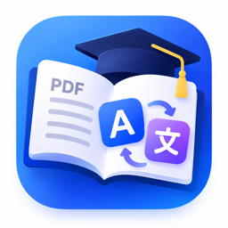

<p align="center"></p>
<h1 align="center">LiRe: A Mac PDF reader for translating and annotating papers</h1>
<p align="center">macOS 14 or later · Apple silicon · Simplified Chinese interface</p>
<p align="center"><a href="https://github.com/kexi0714/light_reader/releases/latest"><strong>Download for Mac</strong></a> · <a href="#install">Installation guide</a> · <a href="README.zh-CN.md">简体中文</a></p>

## Reading a paper with LiRe

| To… | In the reader |
| --- | --- |
| Compare a passage with its translation | Drag across the English text to see Chinese in the sidebar. Scroll while holding the mouse to select across pages, or `⌘`-drag to add separate passages. |
| Mark evidence | Right-click a selection to highlight or underline it. To change its color later, click the mark and choose a toolbar swatch. |
| Write in the margin | Click `T`, then click the page. Notes start at 10 pt and grow to the right as you type. Drag to move or resize them, then press `⌘S` to save annotations in the PDF. |

LiRe takes its name from *light reading*. Open papers in tabs and return to your saved reading position. Reading and annotation work locally. Your configured provider handles translation.

## Requirements

- macOS 14 Sonoma or later.
- An Apple silicon Mac (M1 or later). The default download is an `arm64` build; it does not run on Intel Macs.
- Translation credentials for Baidu Translate or a compatible model service. Provider quotas and charges are handled by your provider.
- PDFs with selectable text for selection-based translation. Image-only scans need OCR in another tool first.

Installed users do **not** need Xcode, Python, Conda, or this source checkout.

## Install

1. Open `LiRe-<version>-macOS-arm64.dmg` from the distributor's release assets, or build it using the instructions below.
2. Drag **LiRe.app** onto **Applications**.
3. Eject the disk image and launch LiRe from Applications.
4. Open **Translation Settings** (`⌘,`) and configure your provider.

The local packaging script uses an **ad-hoc signature** unless a Developer ID signing identity is supplied. It does not notarize the app automatically. A downloaded, unnotarized build may be blocked by macOS. Only for a build you trust, review **System Settings → Privacy & Security → Open Anyway** after trying to open it. Do not disable Gatekeeper globally.

No public release is created by the build scripts. A public distribution should be Developer ID signed and notarized; see [Releasing and upgrades](docs/RELEASING.md).

## Configure translation

### Baidu Translate

Use the gear button at the top of the translation sidebar to configure either provider, test the connection, and save without leaving the sidebar. Choose **返回翻译** to return to reading. Its independent text zoom defaults to 170%, supports 75%–200%, accepts a typed percentage, and remembers your preference. Drag from blank space to select continuously across the original, headings, and translated text, or click the text area and press `⌘A` to select all. Only the original text is editable.

Select **百度翻译** in Translation Settings. Enter the APP ID and secret for Baidu's General Text Translation API, use **测试连接** to test the connection, and click **保存设置** to save.

The app translates English to Simplified Chinese. A single selection must be smaller than 6,000 UTF-8 bytes.

### Custom model endpoint

Select **自定义大模型** and enter:

| Field | Value |
| --- | --- |
| API URL | A compatible base URL, such as `https://your-provider.example/v1`, or its full `/chat/completions` endpoint |
| API key | Your provider's key; it may be empty for a local service that does not require authentication |
| Model | The exact model identifier provided by your service |

Remote endpoints must use HTTPS. HTTP is supported for loopback services such as `localhost` and `127.0.0.1`. The endpoint must accept Chat Completions requests; other model API protocols are not currently supported.

Use **测试连接** to test, then **保存设置** to persist the configuration. All open documents use the saved provider settings.

## Reading and annotating

Open a PDF using the folder button or `⌘O`. You can select several files at once or drag files into the reader. A single document already has a filename tab; additional documents appear to its right. Reopening a file selects its existing tab. The translation sidebar starts alongside the filename tabs. Drag the divider between the paper and translation to adjust the width; the initial sidebar width is 25%, and the adjusted width is shared across tabs in the same window.

Select a passage to translate it. To mark it, right-click and choose **高亮** (highlight) or **下划线** (underline). Selecting a toolbar color only changes the color used by those actions; it does not mark text automatically.

For a note, choose a size beside `T`, click `T`, and click the page. Click elsewhere to finish. Empty notes disappear when you leave the editor; pressing Delete again after clearing all text also removes the note. Existing notes can be edited with a click. Use `⌘S` to save changes into the PDF, or Save As to keep a separate copy.

| Shortcut | Action |
| --- | --- |
| `⌘O` | Open PDF files |
| `⌘S` | Save the current PDF |
| `⌘⇧S` | Save As |
| `⌘W` | Close the current document |
| `⌘Z` / `⌘⇧Z` | Undo / redo |
| `⌘1` | Select and translate |
| `⌘⇧T` | Typewriter note |
| `⌘=` / `⌘-` | Zoom in / out |
| `⌘0` | Fit page |
| `⌘⌥T` | Show or hide the translation sidebar |
| `⌘⇧[` / `⌘⇧]` | Previous / next document tab |
| `⌘,` | Translation settings |

Use **窗口 → 将标签移到新窗口** to detach the selected tab, or **窗口 → 合并所有文献窗口** to merge document windows.

## Local data and privacy

Installed release builds store user data outside the app bundle:

```text
~/Library/Application Support/Light Reader/
├── credentials.json        # Your model and Baidu secrets
├── settings.json           # Provider configuration and settings schema version
├── settings.previous.json  # Previous configuration, when an existing file is saved
└── reading-positions.json  # Reading position and zoom keyed by PDF path
```

Debug builds keep the same files in the source checkout's `.local/` directory. The settings window includes **打开配置文件夹** to open the directory used by that build.

- Credentials are local JSON files protected by owner-only file permissions. They are **not encrypted**, and the app does not use macOS Keychain.
- Selected text is sent to the configured translation service. Testing the connection sends a fixed sample sentence. The app does not upload the PDF file.
- Annotations are saved in the PDF itself. They are not stored in the app's configuration folder.
- Build artifacts never intentionally include credentials, personal PDFs, reading history, or the source checkout. `.local/`, `.build/`, `build/`, and `dist/` are ignored by Git.

The first installed release uses a separate data folder from the development build. Configure it once, or quit both builds and privately copy `credentials.json`, `settings.json`, and optionally `reading-positions.json` from `.local/` to the installed app's configuration folder. Never include these files in a release or commit them.

## Upgrading

If upgrading from Light Reader, quit the old app, install LiRe, then remove the old `Light Reader.app` from Applications. The data directory keeps its original name for compatibility.

Save your documents, quit LiRe, and replace the app in Applications with the newer version. Your settings and keys remain in Application Support, and annotations remain in your PDFs.

The bundle identifier and installed data directory are stable across releases. Settings have their own schema version, can read the original unversioned format, and retain a previous configuration when saved. Unsupported future schemas and corrupt settings are reported instead of being silently overwritten.

Automatic update checks and in-app downloads are **not implemented**. For now, upgrades are manual. See [the release and upgrade contract](docs/RELEASING.md) before changing storage formats or adding an updater.

## Build from source

Install Apple's Command Line Tools or Xcode with a Swift toolchain. The current package uses a Swift tools version of 5.9 and targets macOS 14+. There are no third-party Swift package dependencies.

```sh
# Development app; keeps project-local settings.
./scripts/build.sh debug
open "build/LiRe.app"

# Standalone release app for the current Mac's architecture.
./scripts/build.sh release
open "build/release/LiRe.app"

# Release app targeting Apple silicon explicitly.
./scripts/build.sh release arm64

# Build an Apple silicon app, DMG, and SHA-256 checksum.
./scripts/package.sh

# Run regression checks.
./scripts/check.sh
```

Packaging produces:

```text
build/release/LiRe.app
dist/LiRe-0.1.1-macOS-arm64.dmg
dist/LiRe-0.1.1-macOS-arm64.dmg.sha256
```

Packaging defaults to `arm64` regardless of the build machine. `./scripts/package.sh native` targets the build machine, and `./scripts/package.sh universal` remains available for a possible future Intel release; Intel is not part of the current distribution target. The checks exercise native macOS windows and fonts and should run in a logged-in macOS desktop session. Font-specific checks expect Hannotate SC to be available; the app itself falls back to a system font when it is absent.

## Project structure

```text
Sources/LightReader/          App entry point
Sources/LightReaderKit/       Reader UI, PDF editing, translation, settings, and tabs
Tests/LightReaderKitTests/    Executable regression checks
Resources/                   App metadata and icon
scripts/                     Build, packaging, checks, and version management
docs/                        Project description and release guidance
```

## Project status and license

LiRe is an early-stage desktop application. See [CHANGELOG.md](CHANGELOG.md) for the initial release scope. A source-code license has not yet been selected; an open-source license must be added before presenting the public repository as a licensed open-source project.
